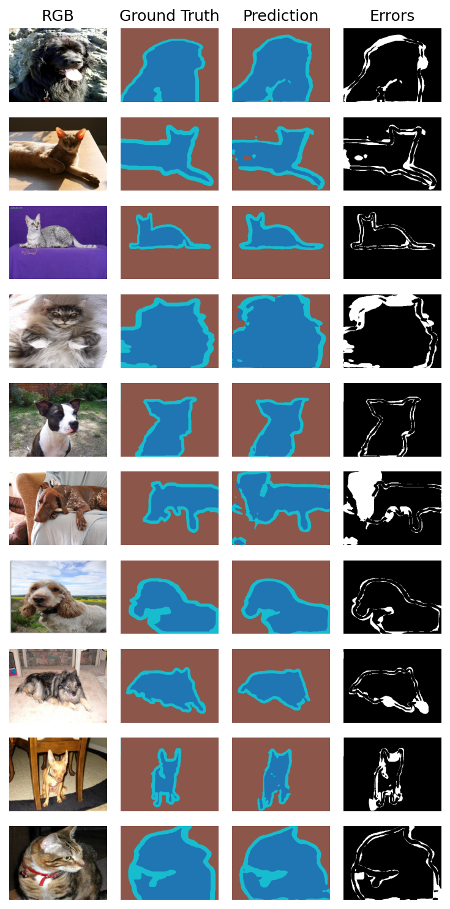

# Segmentation Transformer

A learning project for understanding how transformers can be used for image segmentation. The model is trained on Oxford-IIIT Pet images to label each pixel as pet, background, or boundary.

## Architecture

The model combines a convolutional stem, a transformer encoder, and a convolutional decoder.

- **Encoder:** Convolution layers reduce a 240 × 320 image to a smaller feature grid. The grid becomes a sequence of tokens with position embeddings, which passes through four transformer blocks. Each block lets different parts of the image share information.
- **Decoder:** Features from the four blocks are reshaped into spatial maps at different sizes, then gradually combined and upsampled. Early convolution features are added back to help recover local detail.
- **Output:** The model produces three class scores for every pixel at the original image size. The class with the highest score becomes the predicted label.

The model is called `SegmentationTransformer`. This is a custom implementation for learning. I plan to add hand-drawn explanations of the encoder and decoder later.

## Running it

Use Python 3.10 or newer. Run these commands from the project root.

Install the project and its dependencies:

```bash
python -m pip install -e .
```

If you installed the project before the rename to `segmentation_transformer`, run this install command again to update the editable package path.

Download and check the dataset:

```bash
python scripts/check_dataset.py
```

This automatically downloads Oxford-IIIT Pet into `data/`, prints dataset sizes and tensor shapes, and displays an example image and mask.

Train the model:

```bash
python scripts/train.py
```

Training uses CUDA when available, otherwise CPU. Settings such as the learning rate, batch size, and number of additional epochs are near the top of `scripts/train.py`.

Checkpoints are saved in `checkpoints/segmentation_transformer_pets_v1/`:

- `best.pt` is updated when validation mean IoU improves.
- `latest.pt` is saved after every epoch.

If `best.pt` already exists, training loads its model weights and continues from its saved epoch. The optimizer starts fresh.

Visualize predictions after training:

```bash
python scripts/visualize.py
```

This loads `best.pt` and compares validation images, ground-truth masks, predictions, and pixel errors. The script currently saves `segmentation_results.png` in the project root; the example below is stored in `outputs/`.

## Recent results

An excerpt from the latest training run:

| Epoch | Train loss | Train mIoU | Val loss | Val mIoU |
| --- | --- | --- | --- | --- |
| 57/83 | 0.1113 | 0.8453 | 0.3215 | 0.7484 |
| 58/83 | 0.1109 | 0.8459 | 0.3297 | 0.7475 |
| 59/83 | 0.1103 | 0.8465 | 0.3346 | 0.7459 |
| 60/83 | 0.1097 | 0.8470 | 0.3324 | 0.7453 |

At epoch 60, validation IoU was **0.8361** for pet, **0.9083** for background, and **0.4915** for boundary. Mean IoU is the average IoU across these three classes.



## Current limitation

Boundary detection is the main bottleneck. Boundary pixels are much less common than pet and background pixels, and their IoU is noticeably lower. Training currently uses unweighted cross-entropy; a next experiment is to try class-weighted cross-entropy to give boundary pixels more influence on the loss.
